# 1. Cấu hình gói thành viên trên CMS

Bốn luồng: [khởi tạo gói](#11-khởi-tạo-gói), [dừng gói](#12-dừng-gói), [sửa giá](#13-sửa-giá),
[mở thêm thị trường mới](#14-mở-thêm-thị-trường-mới).

**Vòng đời gói:** `Nháp` → (Mở bán) → `Đang bán` ⇄ (Ngừng bán / Mở bán lại) ⇄ `Ngừng bán` → (Xoá, chỉ khi không đang bán).

**CMS làm gì với store:** CMS gọi core-service, core-service gọi payment-service, payment-service gọi API App Store Connect / Google Play.
CMS **chỉ đẩy lên store ở hai thời điểm:** lúc **Mở bán** và lúc **bật thị trường mới / điều chỉnh giá** trên gói đang bán.
Các thao tác còn lại (sửa tên, ngừng bán, xoá) chỉ ghi vào DB của WeUp.

---

## 1.1. Khởi tạo gói

**Bước 1.** Vào **Gói thành viên → Danh sách gói** (1, 2), bấm **"Tạo gói"** (3).

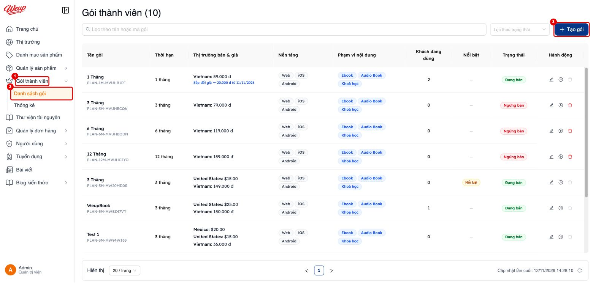

**Bước 2.** Điền thông tin cơ bản:

1. **Tên gói:** tên hiển thị cho khách trên web/app. CMS cũng dùng tên này làm tên sản phẩm trên store.
2. **Thời hạn:** chọn 1 / 3 / 6 / 12 tháng. **Sau khi mở bán thì không đổi được**; muốn đổi thời hạn phải tạo gói mới.
3. **Gói nổi bật:** gắn nhãn ưu tiên trên web/app (đổi lúc nào cũng được).

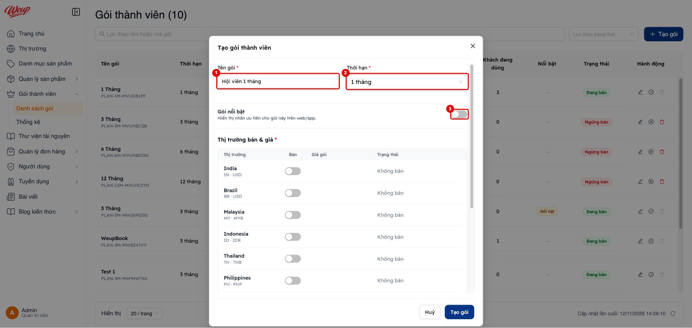

**Bước 3.** Kéo xuống bảng **"Thị trường bán & giá"**:

4. Bật **"Bán"** cho từng thị trường muốn bán.
5. Nhập **giá gói** theo đơn vị tiền ở bên phải ô giá.
6. Bấm **"Tạo gói"**. Gói được lưu ở trạng thái **Nháp** và **chưa đẩy lên store**. Gói nháp sửa thoải mái.

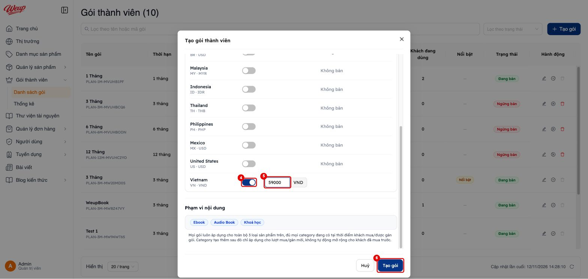

> [!IMPORTANT]
> **Giá phải khớp bậc giá của Apple.** Apple chỉ nhận giá có trong bảng bậc giá (price point) của từng quốc gia.
> Ví dụ VN: 59.000đ, 149.000đ, 20.000đ… Nếu không khớp, lúc mở bán sẽ báo lỗi
> *"Giá X không tồn tại trong ladder… Mức gần nhất Apple hỗ trợ: Y"*. Khi đó sửa giá theo mức Y.
>
> Đơn vị tiền trong bảng giá gói là **tiền của store**, có thể khác cột "Tiền tệ" ở trang Thị trường.
> Ví dụ Malaysia: trang Thị trường ghi USD, bảng giá gói ghi MYR. Luôn nhập theo đơn vị hiện cạnh ô giá.

**Bước 4.** Ở dòng gói **Nháp** (1), bấm biểu tượng **"Mở bán"** (2).

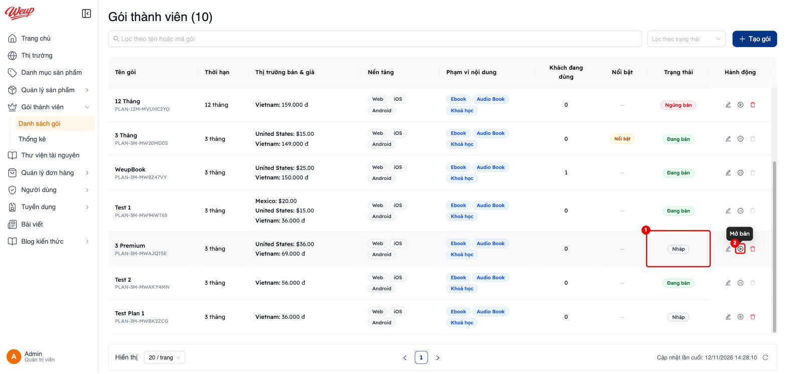

> [!WARNING]
> **"Mở bán" chạy ngay, không có hộp xác nhận.** Bấm là CMS lập tức tạo subscription trên **cả App Store và Google Play**.
> Product ID có dạng `plan_3m_xxxxxxxx`; trên Google còn có base plan `p3m`. Lần đầu có thể mất tới ~45 giây.
> Kết quả:
> - **Thành công cả hai:** thông báo *"Đã mở bán gói …"*.
> - **Lỗi một bên:** gói vẫn chuyển sang Đang bán, CMS cảnh báo *"… đồng bộ App Store/Google Play thất bại — vào Sửa gói, bấm nút "Thử lại"…"*.
> - **Lỗi cả hai:** gói **giữ nguyên Nháp**, thông báo *"Mở bán thất bại"*.

**Bước 5. Kiểm tra trạng thái đồng bộ.** Bấm biểu tượng bút chì (**"Thiết lập gói"**) để mở gói đã mở bán:

- Ở mỗi thị trường, tag **Apple / Google màu xanh** (2) nghĩa là đã đồng bộ giá lên store.
- Nút **xám có biểu tượng tải lại** (1) nghĩa là chưa đồng bộ hoặc bị lỗi. Rê chuột vào để xem lỗi, bấm vào để **thử lại riêng thị trường đó**.
  Dòng chữ cam *"Cần xác nhận đồng bộ Google trước khi điều chỉnh giá"* xuất hiện cho tới khi đồng bộ xong.
- Mục **"Bán trên app"** bên dưới hiện mã sản phẩm trên App Store / Google Play.

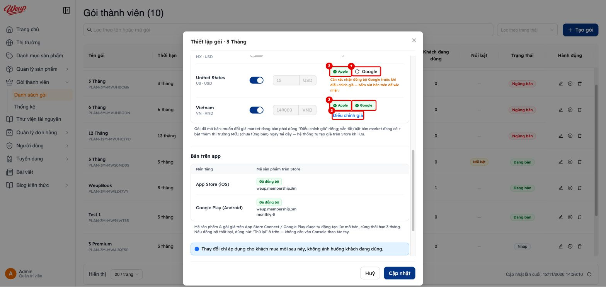

> [!NOTE]
> Tag "Đã đồng bộ" trong mục *Bán trên app* có thể hiện xanh dù Google lỗi hết các vùng (lỗi đã biết).
> **Hãy tin tag Apple/Google ở từng thị trường.**

**Bước 6. Bắt buộc làm tay trên store sau khi mở bán**, xem [mục 2](2-kiem-tra-store.md):

- Kiểm tra **thời hạn** trên ASC và Play. Do lỗi đã biết, gói 3/6/12 tháng đang bị tạo thành 1 tháng.
- Sắp **level** trong nhóm "WeUp Membership" trên ASC: gói dài hơn ở level cao hơn (level 1 là cao nhất).
- Trên ASC: thêm localization tiếng Việt/Anh cho từng gói, ảnh review (Review screenshot) và ghi chú review, rồi **gửi duyệt**.
  CMS **không** tự gửi duyệt.

---

## 1.2. Dừng gói

**Ngừng bán:** ở gói **Đang bán**, bấm biểu tượng **pause** (1).

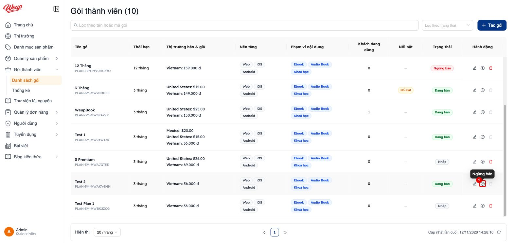

Hộp xác nhận liệt kê hệ quả (1). Bấm **"Ngừng bán"** (2) để xác nhận.

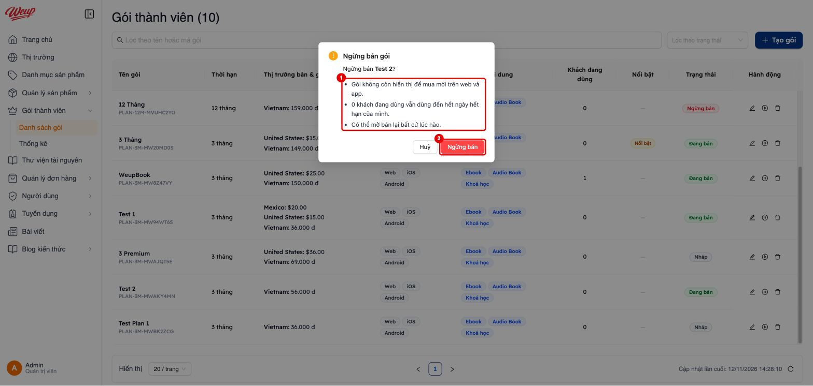

Sau khi ngừng, gói ở trạng thái **Ngừng bán** (1) và có hai nút:
- **"Mở bán lại"** (2): chạy ngay, không hỏi lại.
- **"Xoá"** (3): chỉ bấm được khi gói không còn Đang bán.

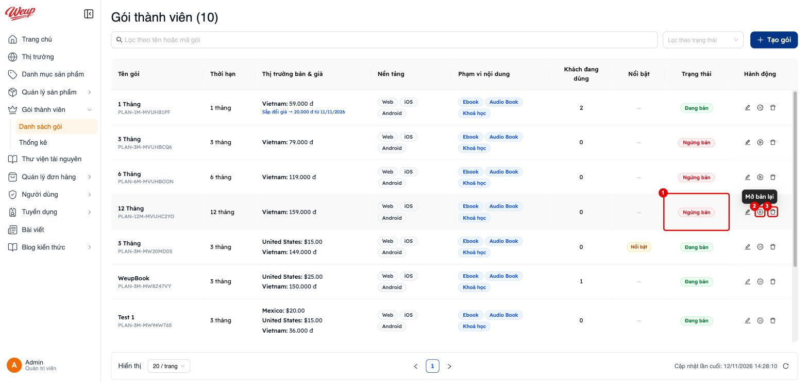

Xoá là **xoá mềm**: gói bị ẩn khỏi danh sách, **không khôi phục được qua giao diện**.

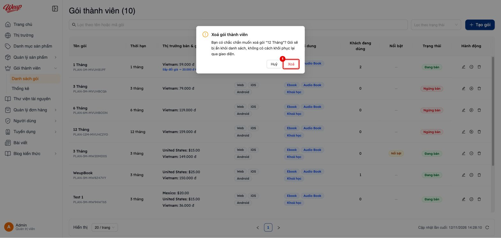

> [!WARNING]
> **Ngừng bán / Xoá / tắt "Bán" một thị trường chỉ ẩn gói trong WeUp, không chạm vào store.** Hệ quả:
> - Khách **đang** subscribe qua store **vẫn tiếp tục tự gia hạn và bị trừ tiền**, và vẫn được cấp quyền mỗi kỳ.
>   Dòng chữ "dùng đến hết ngày hết hạn" trong hộp xác nhận **chỉ đúng với khách Payoo**.
> - Sản phẩm vẫn ở trạng thái bán trên store. Khách có thể mua qua trang App Store (Streamlined Purchasing đang bật).
>
> **Muốn dừng bán hẳn trên store, phải làm tay thêm:**
> - **App Store Connect:** mở subscription → mục **Availability** → **"Remove from Sale"** (xem ảnh [2-05](images/2-05-asc-chi-tiet-goi.jpg), ô số 5).
>   Khách cũ **vẫn gia hạn**, Apple chỉ chặn khách mua mới.
> - **Google Play:** mở subscription → **View base plan** → **"Deactivate"** (ảnh [2-22](images/2-22-play-base-plan.jpg), ô số 2).
>   Khách cũ vẫn gia hạn. Muốn chấm dứt khách cũ thì phải dùng *migrate / cancel* của Google (cần dev).
>
> **Không bao giờ xoá gói có khách đang dùng:** gia hạn của họ vẫn dựa vào bản ghi gói này.

---

## 1.3. Sửa giá

Giá của thị trường **đang bán** bị khoá trong form chính. Đổi giá phải qua luồng riêng **"Điều chỉnh giá"**.
Đây là **thay đổi giá thật**, áp cho cả khách đang dùng.

**Bước 1.** Mở gói (biểu tượng bút chì) → ở thị trường cần đổi, bấm **"Điều chỉnh giá"** (3, ảnh [1-05](images/1-05-trang-thai-dong-bo-thi-truong.jpg)).
Link này chỉ hiện khi:
- gói đang bán,
- thị trường đó đã đồng bộ **cả Apple và Google** (hai tag xanh),
- chưa có lịch đổi giá nào đang chờ.

**Bước 2.** Nhập **"Giá mới"** (1), bấm **"Xác nhận điều chỉnh giá"** (2).

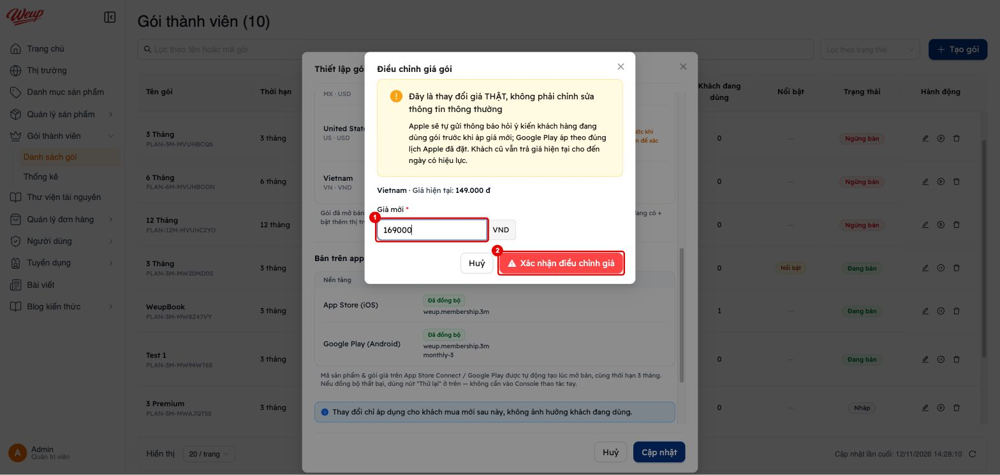

**Hệ thống làm gì sau khi xác nhận:**

| | Apple | Google |
|---|---|---|
| Khi nào áp | Đặt lịch tối thiểu **2 ngày sau** (giờ Pacific). Apple từ chối thì tự lùi ngày, tối đa 5 lần | Áp **đúng ngày Apple có hiệu lực** (job hàng đợi `iap-subscription-price-apply`) |
| Khách mới | Giá mới từ ngày hiệu lực | Giá mới từ ngày hiệu lực |
| Khách cũ | Chuyển sang giá mới (`preserveCurrentPrice=false`). **Tăng giá** thì Apple tự gửi thông báo xin đồng ý | `migratePrices` theo kiểu **OPT_IN**: khách phải đồng ý giá tăng |
| Khách không đồng ý tăng giá | Gói hết hạn ở kỳ kế tiếp | Gói hết hạn ở kỳ kế tiếp |

**Bước 3. Theo dõi.** Thị trường hiện badge **"Chờ áp giá mới"** (1) và dòng *"Sắp đổi giá → … từ …"*.
Bấm **"Huỷ"** (2) để huỷ lịch: hệ thống xoá lịch trên Apple và trả lại giá cũ.

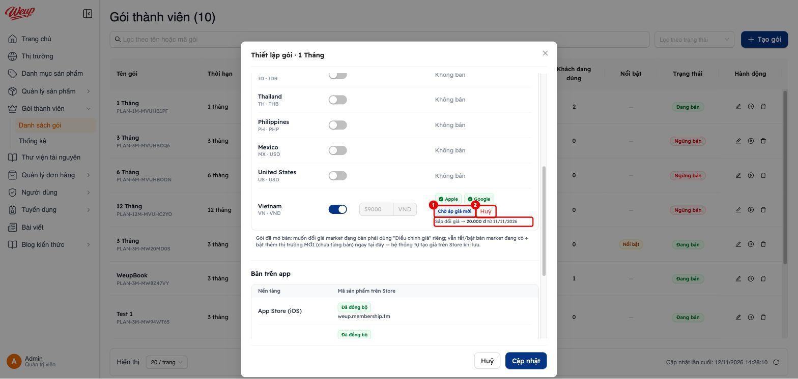

> [!WARNING]
> **Kiểm tra sau ngày hiệu lực.** Nếu job áp giá Google lỗi hết 3 lần retry, CMS **vẫn hiện "Chờ áp giá mới" mãi**.
> Lỗi chỉ nằm trong log server, không hiện trên UI.
>
> Ví dụ thật trên staging (12/11/2026): gói *1 Tháng* vẫn hiện *"Sắp đổi giá → 20.000đ từ 11/11/2026"* dù đã qua ngày.
> Trên ASC, giá VN của `weup.membership.1m` đã là **20.000đ** ([ảnh 2-09](images/2-09-asc-gia-vietnam.jpg)).
> Trong khi đó web/app vẫn hiện 59.000đ.
>
> Sau ngày hiệu lực, luôn **so giá trên CMS với ASC và Play** ([mục 2](2-kiem-tra-store.md)). Lệch thì báo dev kiểm tra log job `iap-subscription-price-apply`.

---

## 1.4. Mở thêm thị trường mới

**Bước 1. Tạo thị trường (nếu chưa có).** Vào **Thị trường** (1) → **"Tạo thị trường"** (2).

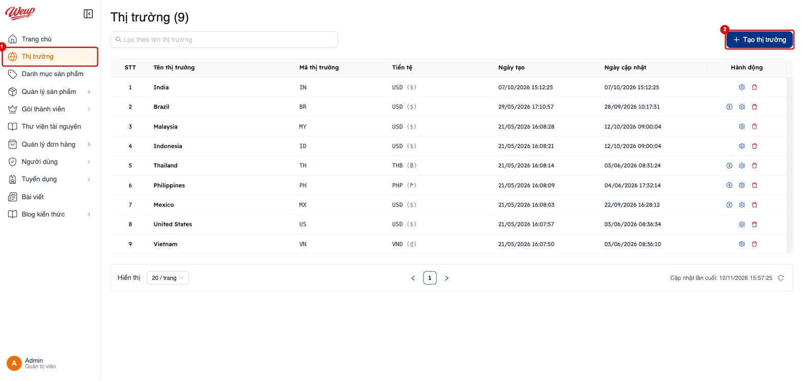

Chọn **Tên thị trường** (1). **Mã thị trường** và **Đơn vị tiền tệ** tự điền (2). Bấm **"Thêm"** (3).

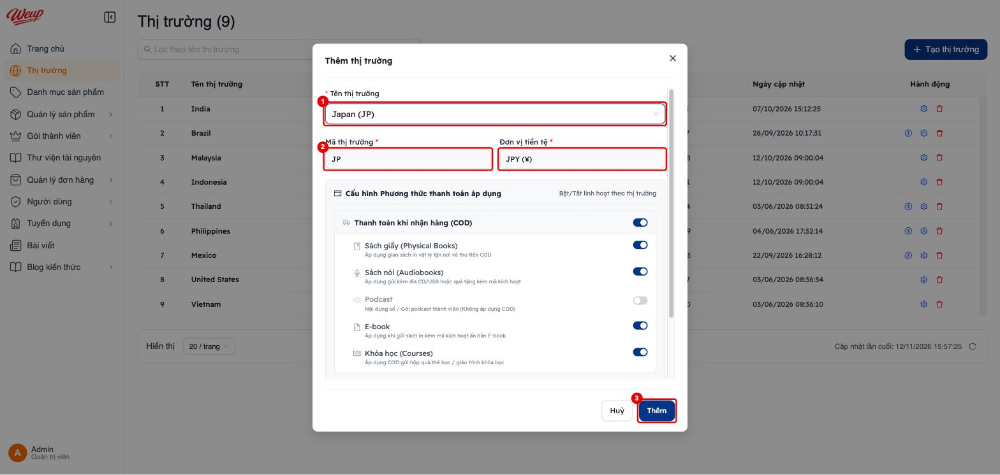

> [!WARNING]
> **Kiểm tra quốc gia có trong bảng ánh xạ Apple chưa.** Code hiện chỉ ánh xạ được **vn, us, en, br, id, in, mx, my, ph, th**
> (`APPLE_CONNECT_TERRITORY_MAP` trong `elearning-core-service/src/shared/constants/market.ts`).
> Mọi mã khác, ví dụ **Japan (JP)** như trong ảnh, **bị đẩy lên Apple thành USA**: giá đè lên thị trường Mỹ.
> **Nhờ dev bổ sung bảng ánh xạ trước** khi bật bán thị trường mới. Google dùng thẳng mã quốc gia nên không bị lỗi này.

**Bước 2. Bật bán thị trường trong gói đang bán.** Mở gói → bật **"Bán"** ở thị trường mới (1) → nhập **giá** (2).
CMS hiện *"Thị trường mới — tự động tạo trên Store khi lưu"* → bấm **"Cập nhật"** (3).

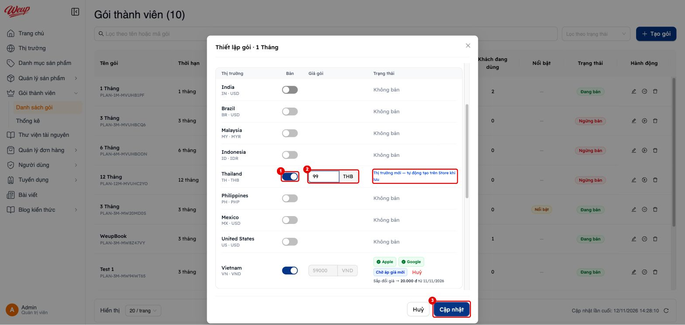

Khi lưu, hệ thống làm những việc sau:
- **Apple:** thêm quốc gia vào *Availability* và đặt giá gốc.
- **Google:** thêm region vào base plan, cho phép khách mới mua.

Lỗi đồng bộ **không** làm hỏng thao tác lưu: thị trường vẫn bật, chỉ tag Apple/Google để xám. Bấm tag xám để thử lại (như bước 5 mục 1.1).
Gói **Nháp** chỉ cần bật thị trường; thị trường sẽ được đồng bộ lúc **Mở bán**.

**Bước 3.** Kiểm tra trên ASC (giá theo quốc gia, ảnh [2-08](images/2-08-asc-gia-theo-quoc-gia.jpg) và [2-09](images/2-09-asc-gia-vietnam.jpg))
và trên Play (giá theo khu vực, ảnh [2-23](images/2-23-play-gia-khu-vuc.jpg)).
Nếu quốc gia mới dùng ngôn ngữ khác, thêm localization cho gói trên ASC. CMS chỉ ghi **một** ngôn ngữ.

> [!NOTE]
> **Tắt rồi bật lại** một thị trường trên gói đang bán được tính như **thị trường mới**: ô giá mở lại và hệ thống đồng bộ lại lên store.
> Nếu nhập giá khác giá cũ, Apple nhận lịch giá (≥ 2 ngày), còn Google đổi **ngay** mà không migrate khách cũ.
> **Bật lại thì giữ nguyên giá cũ**; muốn đổi giá thì dùng "Điều chỉnh giá".

---

## Lỗi đã biết của luồng CMS (đề xuất tách ticket)

| # | Lỗi | Ảnh hưởng | Cách né hiện tại |
|---|---|---|---|
| K1 | Core không gửi thời hạn khi tạo gói trên store, nên mọi gói thành **1 tháng** (`sync-apple-subscription` / `sync-google-subscription`) | Gói 3/6/12 tháng bị bán và gia hạn như gói tháng | Chỉ mở bán gói 1 tháng; hoặc sửa tay trên ASC trước khi gửi duyệt ([2](2-kiem-tra-store.md#lỗi-thời-hạn)) |
| K2 | Apple `groupLevel` luôn = 1 | Đổi 1M → 3M thành "crossgrade" (áp ở kỳ sau) thay vì nâng cấp ngay | Sắp lại level tay trên ASC |
| K3 | Ngừng bán / Xoá / tắt thị trường không gọi store | Khách store tiếp tục bị trừ tiền | Remove from Sale (ASC) / Deactivate base plan (Play) bằng tay |
| K4 | Mã thị trường ngoài bảng ánh xạ thành Apple USA | Giá sai, đè thị trường US | Bổ sung `APPLE_CONNECT_TERRITORY_MAP` trước khi mở thị trường |
| K5 | Tag "Đã đồng bộ" của Google có thể sai | Tưởng đã bán được trên Android | Xem tag theo từng thị trường |
| K6 | Bật lại thị trường bị coi là thị trường mới | Giá có thể lệch giữa Apple và Google | Giữ giá cũ khi bật lại |
| K7 | Job áp giá Google lỗi không báo trên UI | CMS hiện "Chờ áp giá mới" mãi | Đối chiếu giá sau ngày hiệu lực |
| K8 | Câu chữ sai: "Thay đổi chỉ áp dụng cho khách mua mới…" trong form gói; "khách đang dùng vẫn dùng đến hết ngày hết hạn" khi ngừng bán | Admin hiểu sai | Đọc tài liệu này |
