# 2. Kiểm tra gói trên App Store Connect / Google Play Console và gửi duyệt

Làm mục này **mỗi lần mở bán gói mới, đổi giá hoặc mở thị trường mới** trên CMS ([mục 1](1-cms-cau-hinh-goi.md)).
Mục tiêu: tên, giá, thời hạn và thị trường trên store **khớp đúng CMS**.
Riêng Apple phải **gửi duyệt** thì gói mới hiện trên app production.

## Bảng đối chiếu (điền cho từng gói)

| Kiểm tra | CMS | App Store Connect | Google Play |
|---|---|---|---|
| Product ID | mục "Bán trên app" trong gói | **Product ID** | **Product ID** |
| Tên hiển thị | Tên gói | Localization: **Display Name** (vi + en) | Tên subscription / listing |
| Thời hạn | Thời hạn | **Subscription Duration** | Base plan → **Type** (Monthly / Every 3 months…) |
| Giá từng thị trường | Bảng "Thị trường bán & giá" | **Subscription Prices** theo quốc gia | Base plan → **Price and availability** |
| Thị trường | Các dòng bật "Bán" | **Availability** | Countries / regions của base plan |
| Trạng thái | Đang bán | **Ready for Sale** (đã duyệt) | Base plan **Active** |
| Level (Apple) | gói dài hơn = cao hơn | **Level** trong group | — |

---

## 2.1. App Store Connect

**Bước 1.** App **WeupBook** → **MONETIZATION → Subscriptions** (1) → nhóm **WeUp Membership** (2).

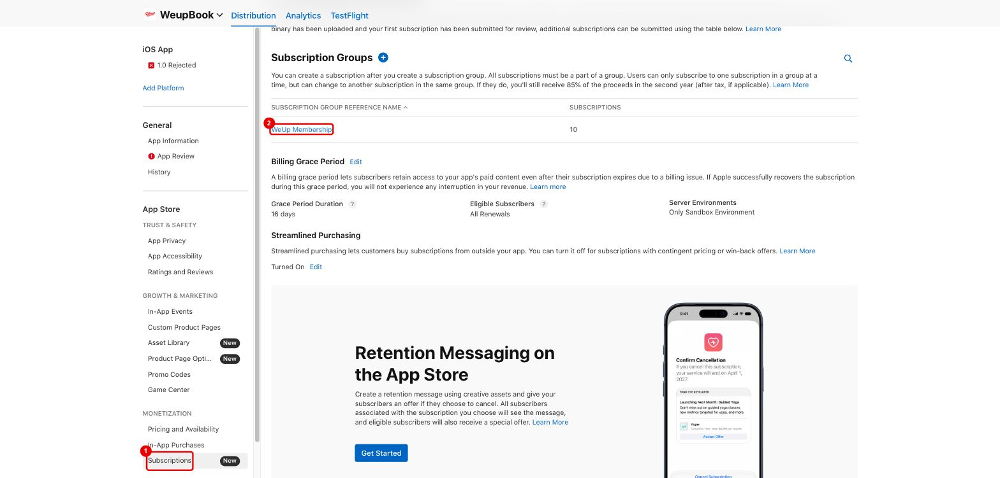

Cùng trang này, kiểm tra cấu hình chung của nhóm:
- **Billing Grace Period** (1): 16 ngày. Hiện **Server Environments = "Only Sandbox Environment"** (2).
  Khi go-live phải bấm **Edit** để bật cho **Production**, xem [mục 6](6-go-live-checklist.md).
- **Streamlined Purchasing** (3): đang **On**. Contract v2 chấp nhận để On:
  core gắn giao dịch không có `appAccountToken` cho user đang đăng nhập lúc verify.

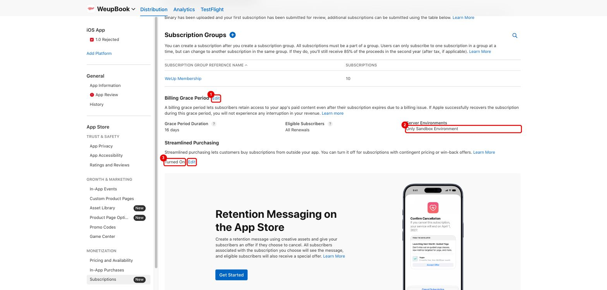

**Bước 2. Danh sách gói trong nhóm.** Kiểm tra cột **Level** (1), **Duration** (3) và trạng thái từng dòng.
Bấm **Edit** (2) để kéo thả, sắp lại level: **level 1 là cao nhất**, và gói **dài hơn phải ở level cao hơn**
(ví dụ 12M = level 1, 6M = 2, 3M = 3, 1M = 4).
Dòng khung đỏ là ví dụ lỗi K1: gói **12 Tháng** nhưng *Duration = 1 month*.

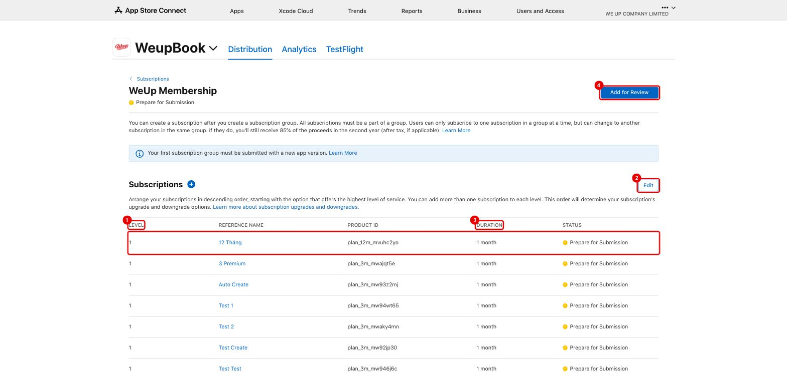

Kéo xuống cuối trang để kiểm tra **localization của nhóm** (1): cần có tiếng Việt và tiếng Anh.
Ở đây cũng thấy cặp gói tạo tay `weup.membership.3m` (level 1) / `weup.membership.1m` (level 2) có level đúng (2).

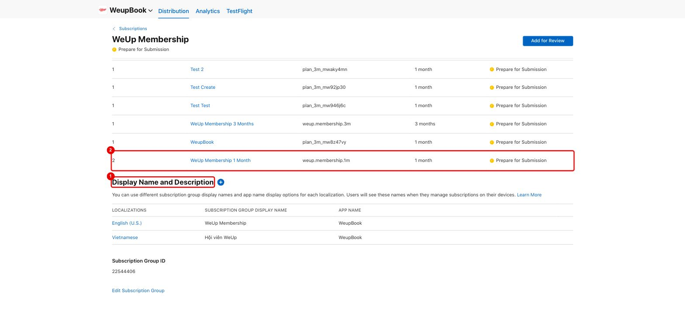

**Bước 3. Kiểm tra từng gói.** Bấm vào tên gói:

1. **Product ID** khớp CMS.
2. **Subscription Duration** khớp thời hạn CMS. Xem [lỗi thời hạn](#lỗi-thời-hạn).
3. **Family Sharing** phải **tắt** (đang hiện "Turn On" là đúng). **Không bật**, vì bật rồi Apple không cho tắt lại.
4. **Availability**: chỉ các quốc gia đang bán trên CMS.
   Gói CMS tạo chỉ mở đúng các quốc gia đã bật. Gói tạo tay `weup.membership.*` đang mở **175 quốc gia**.
5. **Remove from Sale**: dùng khi dừng bán ([mục 1.2](1-cms-cau-hinh-goi.md#12-dừng-gói)).
6. **All Prices and Currencies**: xem và tải bảng giá.

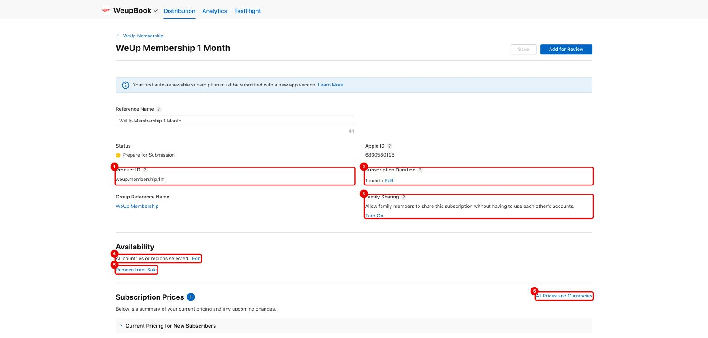

Kiểm tra **Display Name and Description** (1): có cả **Vietnamese** và **English (U.S.)**, tên và mô tả rõ nghĩa.
Ví dụ cần sửa: bản tiếng Việt của `weup.membership.1m` đang để mô tả là "1 Tháng".

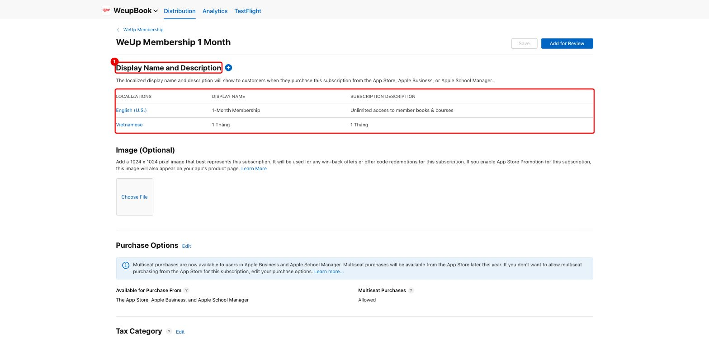

Kéo xuống **Review Information** (1). **Bắt buộc**:
- 1 **ảnh chụp màn hình** paywall trong app (Choose File).
- **Review Notes** hướng dẫn reviewer tìm gói.

Thiếu ảnh thì không gửi duyệt được. **"Add for Review"** (2) đưa gói vào lần gửi duyệt.

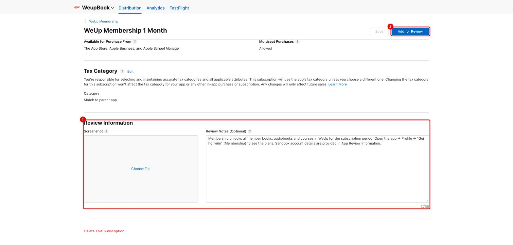

**Bước 4. Đối chiếu giá.** Trong gói → **View all Subscription Pricing**:
- **Starting Price** (1) mở bảng giá theo quốc gia.
- **Download** (2) tải CSV để so với CMS.

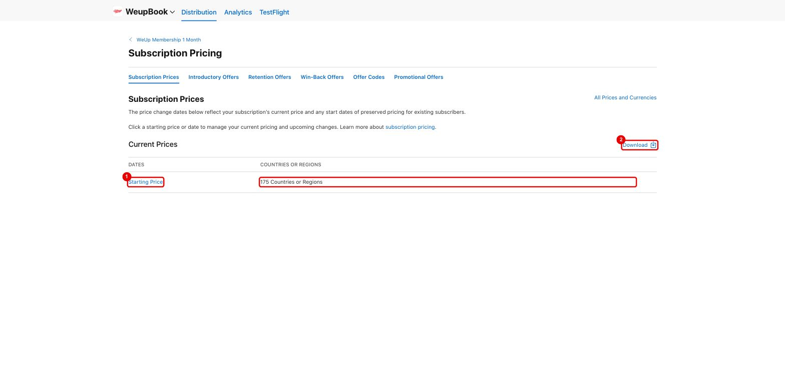

Tìm từng quốc gia đang bán, ví dụ **Vietnam (VND)** (1), so với giá CMS. Bảng cũng có *Year 1 / Year 2 Proceeds*:
đó là số tiền WeUp nhận sau phí Apple, dùng cho [đối soát](5-doi-soat.md).

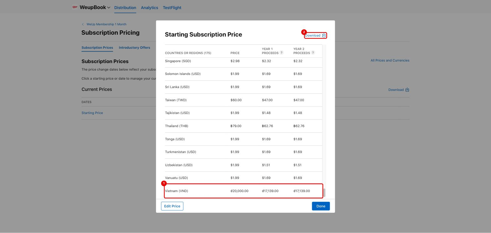

> [!WARNING]
> Ví dụ lệch thật (12/11/2026): trên ASC `weup.membership.1m` ở VN là **20.000đ**, còn CMS/web hiện **59.000đ**
> kèm "Chờ áp giá mới" ([mục 1.3](1-cms-cau-hinh-goi.md#13-sửa-giá)). Lệch kiểu này phải xử lý **trước khi** gửi duyệt.

**Bước 5. Gửi duyệt (Submit for review).**

- **Lần đầu tiên**, nhóm subscription phải đi **kèm một phiên bản app**:
  1. Vào **iOS App → phiên bản đang chuẩn bị** → mục **In-App Purchases and Subscriptions** → **Add** → chọn các gói **thật**.
     **Không chọn gói test**, xem [mục 7](7-don-dep-san-pham-test.md).
  2. Chọn build có tính năng subscription (cờ `ENABLE_STORE_SUBSCRIPTIONS=true`).
  3. **Add for Review** → **Submit for Review**.
- **Các lần sau** (app đã có subscription được duyệt): mở gói → **Add for Review** → ở trang *App Review* bấm **Submit**. Không cần phiên bản app mới.
- Duyệt xong, trạng thái gói chuyển **Ready for Sale** thì gói mới hiện trên app production.

> [!IMPORTANT]
> **Hiện trạng (12/11/2026): iOS 1.0 đang "Rejected"** (1), lý do *2.1.0 Performance: App Completeness* (2).
> Mục *In-App Purchases and Subscriptions* chưa hiện vì phiên bản đang ở trạng thái bị từ chối.
> Phải xử lý lý do từ chối, chọn build mới rồi **Update Review** (3).
> Gắn subscriptions vào phiên bản trước khi gửi lại. Xem [mục 6](6-go-live-checklist.md).

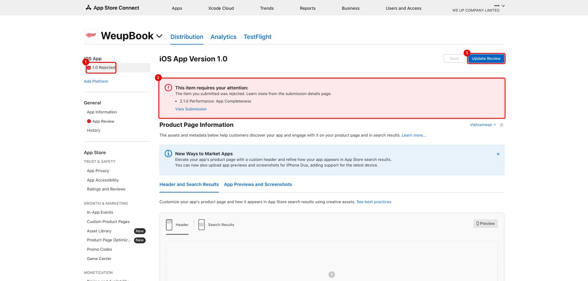

### Lỗi thời hạn

**Trên Apple:** trong ảnh 2-05, ô số 2 có nút **Edit** cạnh *Subscription Duration*, **chỉ khi gói chưa từng được duyệt**.
Trước khi gửi duyệt, sửa tay về đúng thời hạn CMS.
Core cấp quyền theo `expiresAt` mà store trả về, nên sửa trên ASC là đủ để khách được đúng số ngày.

**Trên Google:** base plan đã **Active** thì **không sửa được kỳ hạn**. Phải để dev sửa lỗi K1 rồi tạo gói mới.
Cho tới lúc đó, **không mở bán gói 3/6/12 tháng trên production**.

---

## 2.2. Google Play Console

**Bước 1.** **Monetize with Play** (biểu tượng thẻ giá, 1) → **Products → Subscriptions**.
- Cột **Active base plans** (2): gói đang bán phải có **1**.
- Bấm **View subscription** (3) ở gói cần kiểm tra.

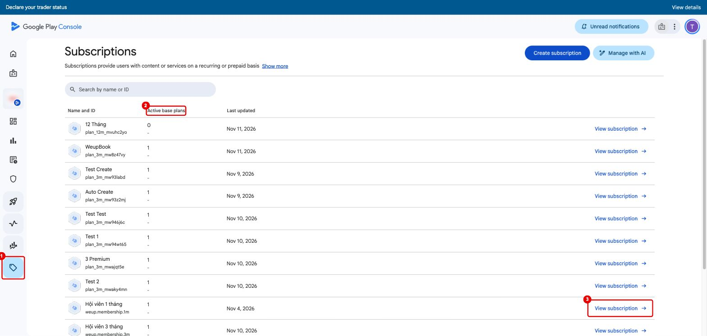

**Bước 2. Chi tiết subscription.** Kiểm tra:
1. **ID base plan**: `p{n}m` với gói CMS tạo, `monthly-1` / `monthly-3` với gói tạo tay.
2. **Kỳ hạn**: ví dụ trong ảnh là gói **3 tháng** nhưng ghi *"Monthly, auto-renewing"* (lỗi K1).
3. Số **quốc gia / khu vực**.
4. **Trạng thái: Active**.
5. **View base plan** để xem chi tiết.

Mục *Benefits* nên điền 1–4 dòng quyền lợi; khách thấy dòng này trên trang quản lý gói của Google.

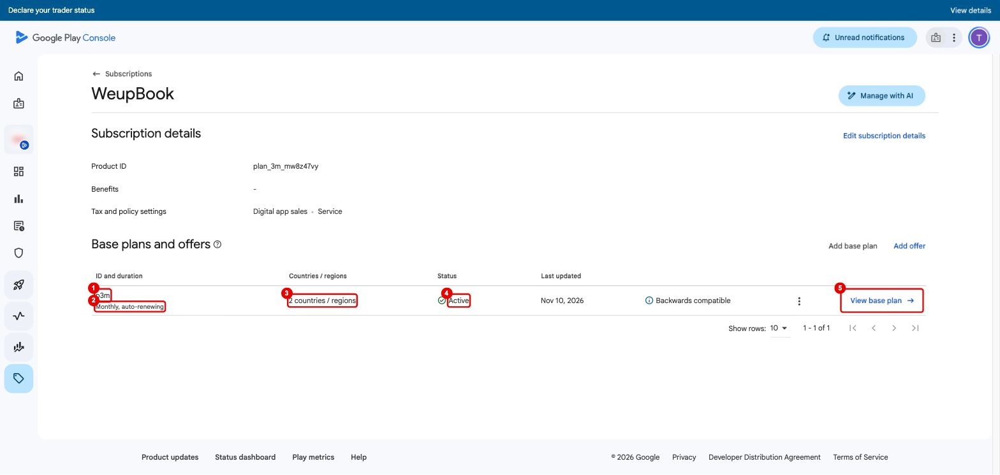

**Bước 3. Base plan.** Kiểm tra:
1. **Type** (kỳ hạn) khớp CMS.
2. **Deactivate**: dùng khi dừng bán ([mục 1.2](1-cms-cau-hinh-goi.md#12-dừng-gói)). **Chỉ bấm khi thực sự muốn dừng.**
3. **Grace period 7 ngày** + *53 day account hold* (tự tính).
4. **Resubscribe: Allow**.

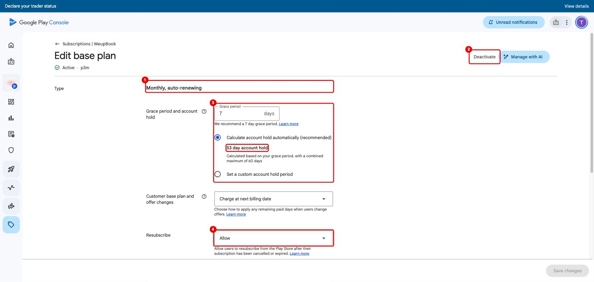

Kéo xuống **Price and availability**:
1. **Manage country / region availability**: quốc gia đang bán.
2. **Set prices**: sửa giá. **Không sửa giá ở đây**, sửa qua CMS "Điều chỉnh giá" để Apple và Google đi cùng lịch.
3. Giá từng quốc gia, ví dụ **Vietnam VND 150,000**, so với CMS.

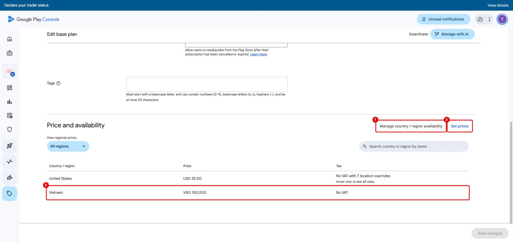

> [!NOTE]
> Google **không có bước duyệt riêng** cho subscription. Base plan **Active** là bán được ngay cho bản app production đang chạy.
> Gói chỉ hiện với khách khi backend production trả gói đó trong `GET subscription/plans`,
> và app production bật cờ `ENABLE_STORE_SUBSCRIPTIONS`.

> [!WARNING]
> **Không tạo subscription bằng tay trên Play Console.** Luôn tạo qua CMS. Subscription tạo tay sẽ lệch cấu hình vùng/giá với code đồng bộ.
