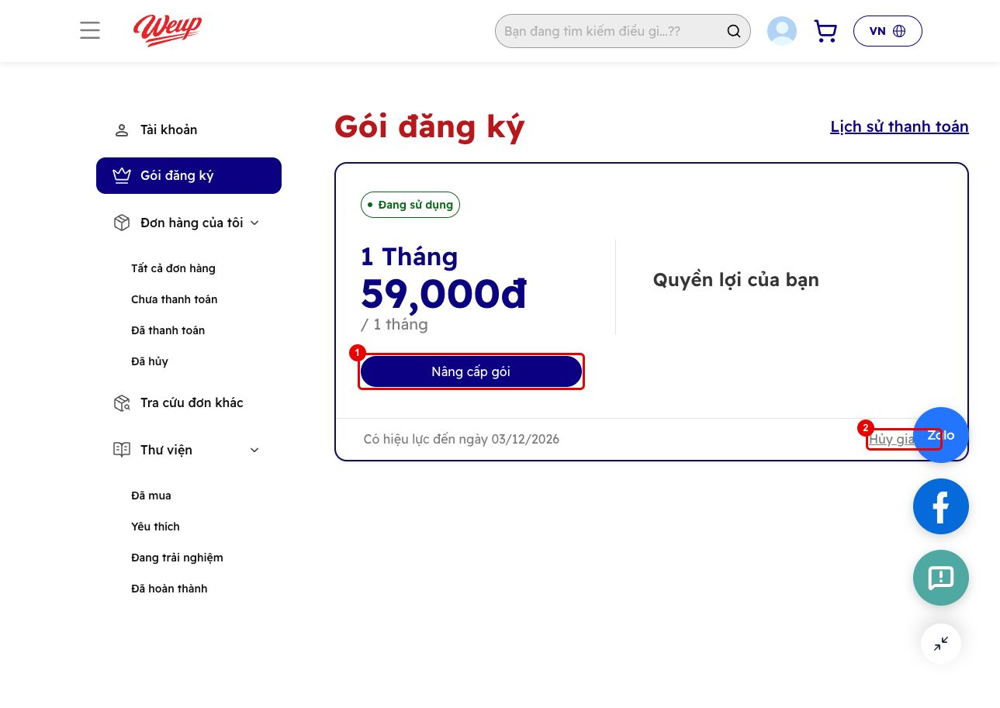
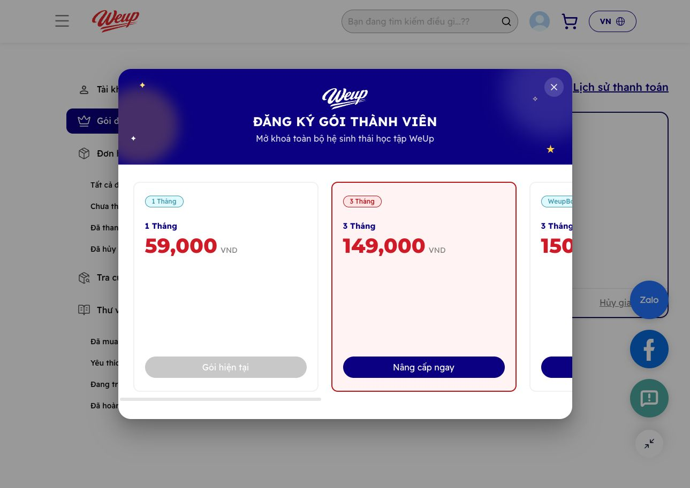
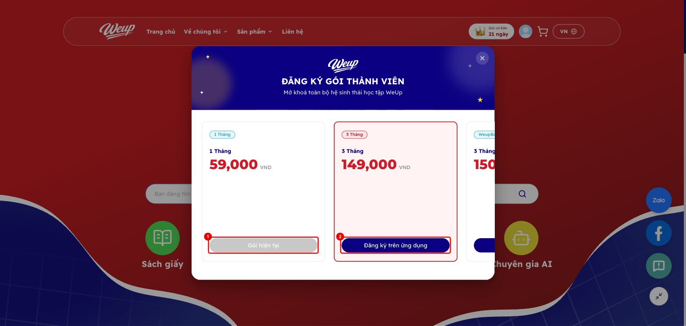
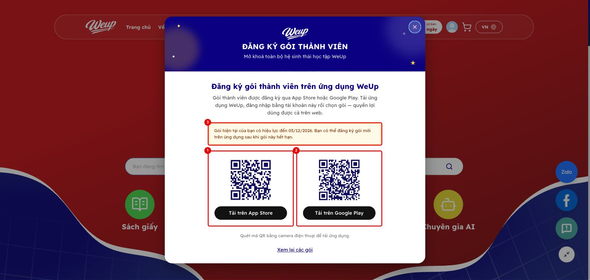
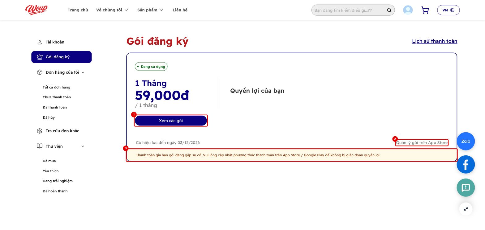

# 3. Web E-learning: mua gói thành viên chuyển sang app

Từ bản này, gói thành viên **chỉ bán qua App Store / Google Play**. Web không còn thanh toán gói qua Payoo
mà dẫn khách sang tải app.

- Repo: `elearning-fe`, nhánh `feat/subscription-download-app`.
- PR vào `dev`: https://github.com/WEUP-IT-DEPARTMENT/elearning-fe/compare/dev...feat/subscription-download-app

## Trước và sau

| Nơi | Trước | Sau |
|---|---|---|
| Modal "Đăng ký gói thành viên" (từ badge header, trang Gói đăng ký) | Nút "Chọn gói" → trang thanh toán Payoo; hội viên thì "Nâng cấp ngay" (trừ tiền Payoo) | Nút **"Đăng ký trên ứng dụng"** → màn hình tải app: nút App Store / Google Play; QR trên máy tính; trên điện thoại ưu tiên store của máy |
| Link cũ `/subscription/checkout?planId=…` | Form thanh toán Payoo | Chuyển về trang chủ và mở màn hình tải app |
| Trang kết quả thanh toán Payoo thất bại | "Thử lại" → checkout | "Thử lại" → màn hình tải app |
| Profile → Gói đăng ký, khách **Payoo** | "Nâng cấp gói" + "Hủy gia hạn" | **"Xem các gói"** + "Hủy gia hạn" (giữ nguyên) |
| Profile → Gói đăng ký, khách **App Store / Google Play** | "Hủy gia hạn" (Payoo, backend từ chối) | **"Quản lý gói trên App Store / Google Play"** (mở trang quản lý gói của store) + cảnh báo khi store báo lỗi thanh toán (grace / on hold) |

**Trước:** trang Gói đăng ký có "Nâng cấp gói" (1) và "Hủy gia hạn" (2), và modal bán gói qua Payoo.

**Sau: modal gói.** Gói đang dùng bị khoá (1), các gói khác hiện **"Đăng ký trên ứng dụng"** (2).

**Sau: màn hình tải app.**
- QR + nút **App Store** (1) và **Google Play** (2).
- Thông báo (3) hiện khi khách đang có gói:
  - **Gói Payoo/admin còn hạn:** *"…có thể đăng ký gói mới trên ứng dụng sau khi gói này hết hạn"*. App chặn mua chéo kênh.
  - **Gói store:** *"…Đổi gói ngay trong ứng dụng WeUp"*.

**Sau: khách mua qua store.**
- **"Xem các gói"** (1).
- **"Quản lý gói trên App Store"** (2): mở `apps.apple.com/account/subscriptions`.
  Khách Google mở `play.google.com/store/account/subscriptions?sku=…&package=com.weup.book`.
- Cảnh báo lỗi thanh toán (3).

## Ghi chú vận hành

- **Link App Store chỉ hoạt động khi app iOS đã lên App Store.** Hiện bản 1.0 đang bị từ chối ([mục 2](2-kiem-tra-store.md)).
  Link nằm trong `packages/constants/src/app-download.ts`. Đổi link thì phải tạo lại ảnh QR
  (`apps/web/public/assets/images/app-download/qr-*.svg`).
- **Khách Payoo đang dùng** vẫn được "Hủy gia hạn" trên web như cũ. Hết hạn gói Payoo thì mua tiếp trên app.
- Code thanh toán Payoo cho gói vẫn giữ trong repo nhưng không còn đường vào. Xoá hẳn khi kinh doanh chốt không bán gói trên web nữa.
- **CSKH:** khách hỏi "huỷ gói" mà gói mua qua store → hướng dẫn huỷ trong *Cài đặt → Apple ID → Đăng ký* (iOS)
  hoặc *Play Store → Thanh toán & gói đăng ký* (Android). WeUp **không huỷ hộ được**.
- Ba locale `es`, `jm`, `za` chưa có bản dịch phần gói thành viên (đã thiếu từ trước).
