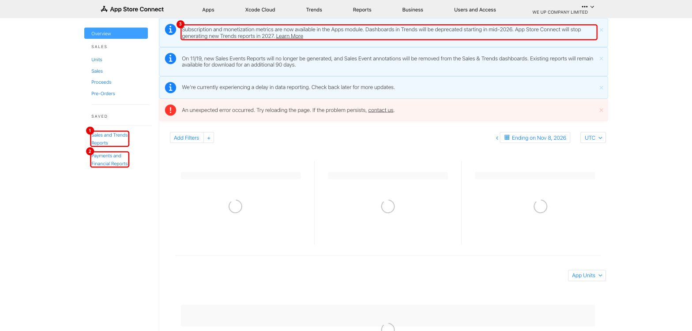
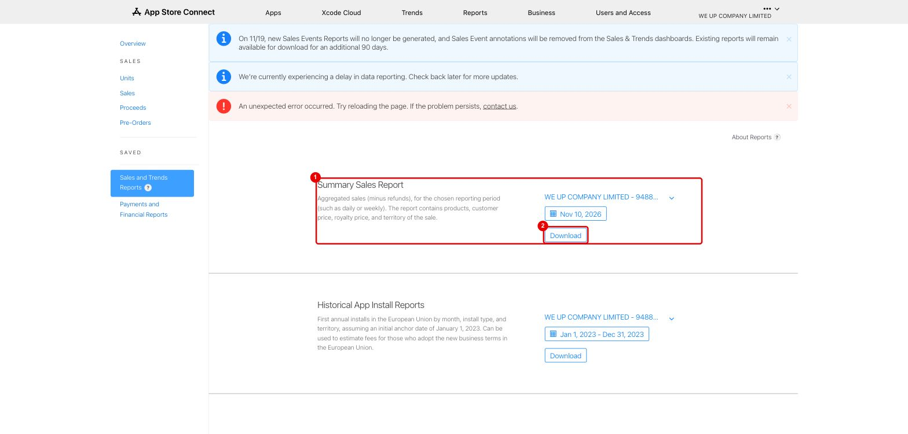
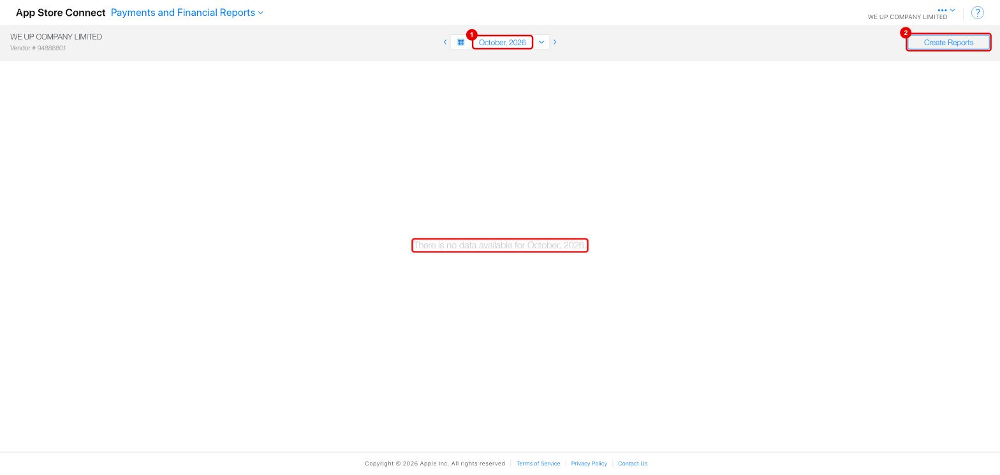
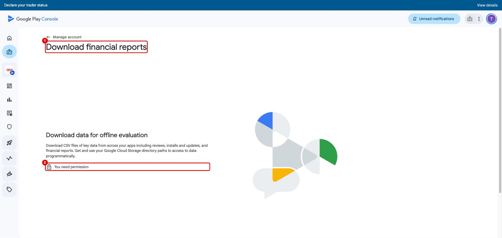
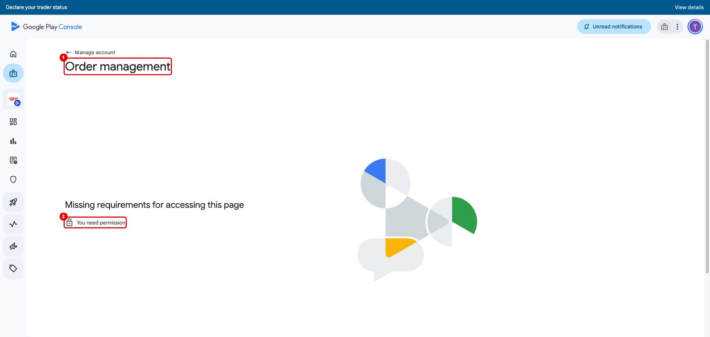

# 5. Đối soát doanh thu subscription với Apple / Google

Đối chiếu ba nguồn:
- **Store** (App Store Connect, Google Play Console): số tiền thật khách trả và số tiền WeUp nhận.
- **Dữ liệu WeUp** (`iap_transactions`, `orders`): những kỳ hệ thống đã ghi nhận và cấp quyền.

**Phần A** dành cho kế toán (thao tác trên console). **Phần B** dành cho dev/data (SQL lấy dữ liệu nội bộ).

> [!IMPORTANT]
> **Quyền truy cập (12/11/2026):**
> - Tài khoản dev hiện tại **không mở được** *Download financial reports* và *Order management* trên Play Console
>   (ảnh [5-01](images/5-01-play-financial-reports.jpg), [5-02](images/5-02-play-order-management.jpg)).
>   Owner tài khoản Play cần cấp cho người đối soát quyền **View financial data, orders, and cancellation survey responses**
>   và **Manage orders and subscriptions** (Users and permissions).
> - Trên ASC, người đối soát cần vai trò **Finance** (hoặc Admin / Account Holder).

## Quy ước chung

| | Apple | Google |
|---|---|---|
| Mã kỳ thanh toán (mỗi lần trừ tiền) | `transactionId` | Order ID `GPA.xxxx-xxxx-xxxx-xxxxx`; kỳ gia hạn thêm hậu tố `..0`, `..1`… |
| Mã chuỗi gói (không đổi khi gia hạn) | `originalTransactionId` | `purchaseToken` đầu tiên |
| Báo cáo có mã giao dịch từng dòng? | **Không.** Báo cáo Apple là số tổng theo SKU × quốc gia, nên đối soát **theo tổng** | **Có.** Đối soát **từng order** |
| Phí store | 30% năm đầu, 15% từ năm thứ 2 nếu khách gia hạn liên tục (đổi gói trong cùng group vẫn tính liên tục); 15% ngay từ đầu nếu WeUp tham gia App Store Small Business Program | 15% cho subscription |
| Thuế | Apple khấu trừ/thu hộ theo quốc gia | Google thu hộ VAT ở các nước áp dụng |
| Kỳ báo cáo | Tháng tài chính Apple (fiscal month) và theo giờ Pacific, **không** trùng tháng dương lịch | Tháng dương lịch, giờ Pacific (PT) |
| Giao dịch sandbox / test | Không lên báo cáo | Giao dịch license tester không lên báo cáo tài chính |

Phía WeUp, các trường hợp cần biết:
- **Hoàn tiền:** `iap_transactions.status = 'revoked'`. **`orders.status` vẫn là `completed`**, nên tính doanh thu từ `orders` một mình sẽ bị dư.
- **`rejected_cross_channel`:** store **đã trừ tiền** nhưng WeUp từ chối cấp quyền, và **không tạo order**.
  - Google tự revoke + hoàn tiền.
  - **Apple phải hoàn tay** qua ticket Apple (core có gửi cảnh báo).
  - Các dòng này **có trên báo cáo store** nhưng không có trong `orders`.
- **Sandbox:** `iap_transactions.environment = 'sandbox'`, `orders.buyer_name` bắt đầu bằng `TEST `. **Loại khỏi đối soát.**
- `created_at` trong DB lưu theo **UTC**.

---

## Phần A — Kế toán (hàng tháng)

### A1. Apple

1. **Trends** → **Sales and Trends Reports** (1); **Payments and Financial Reports** (2) để lấy số tiền thực nhận.
   Lưu ý (3): Apple sẽ ngừng Dashboards Trends dần từ giữa 2026.
   Chỉ số subscription chuyển sang mục **Analytics** của app, nhưng báo cáo tải về vẫn còn.

   

2. **Summary Sales Report** (1): chọn **Monthly** + tháng cần đối soát → **Download** (2).
   Lọc dòng *Product Type Identifier* là subscription tự gia hạn (`IAY`). Các cột dùng để đối chiếu:
   - **SKU** (= Product ID, ví dụ `plan_3m_xxxx`)
   - **Country Code**
   - **Units**
   - **Customer Price** / **Customer Currency**
   - **Developer Proceeds**

   

3. **Payments and Financial Reports:** chọn tháng tài chính (1) → **Create Reports** (2) (hoặc tải từng vùng).
   Báo cáo tài chính có:
   - **Quantity**, **Partner Share**, **Extended Partner Share**, **Country of Sale**, **Customer Price**
   - dòng **Sales or Return** (`R` = hoàn tiền)
   - số tiền chuyển về tài khoản ngân hàng, kèm tỷ giá.

   Ảnh chụp tháng 10/2026: *"There is no data available"*, do chưa có doanh thu thật.

   

4. **So khớp:** lấy kết quả truy vấn **B2** (dev cung cấp), so theo `SKU × quốc gia × đơn vị tiền`:
   - `Units` (Apple, dòng bán) = `units_completed` (WeUp)
   - `Units` dòng hoàn (Return) = `units_revoked`
   - `Customer Price × Units` ≈ `gross_customer_price`
   - `Extended Partner Share` = số WeUp thực nhận. Dùng số này để hạch toán doanh thu và ghi phí Apple = phần chênh lệch.

5. **Chênh lệch thường gặp:**
   - **Lệch kỳ:** tháng tài chính Apple khác tháng dương lịch. Lọc WeUp theo đúng ngày bắt đầu/kết thúc ghi trên báo cáo Apple.
   - **WeUp thiếu dòng:** webhook đến trễ hoặc giao dịch còn `pending`. Báo dev chạy **B4**.
   - **Apple có, WeUp không có order:** giao dịch `rejected_cross_channel` (**B3**). Kiểm tra đã hoàn tiền chưa.
   - **Lệch giá:** đang có lịch đổi giá ([mục 1.3](1-cms-cau-hinh-goi.md#13-sửa-giá)), hoặc khách cũ còn giữ giá cũ khi Apple cho phép.

### A2. Google

1. **Download reports → Financial**:
   - **Earnings reports** (tháng): một dòng cho mỗi phát sinh. Cột *Transaction Type*: `Charge`, `Google fee`, `Tax`, `Charge refund`.
     Cột *Description* = **Order ID** `GPA…`.
   - **Estimated sales reports** (cập nhật hằng ngày): *Order Number*, *Order Charged Date*, *Financial Status*, *SKU ID*,
     *Currency of Sale*, *Item Price*, *Charged Amount*, *Country of Buyer*.

   

2. **Order management:** tra cứu, hoàn tiền từng order `GPA…` (hiện tài khoản dev chưa có quyền).

   

3. **So khớp theo từng order:**
   - *Description / Order Number* (Google) = `store_period_id` của truy vấn **B1** (`platform = google`).
   - `Charge` mà WeUp không có (hoặc có với `status = rejected_cross_channel`) → kiểm tra đã refund chưa.
   - `Charge refund` → WeUp phải có `status = revoked`.
   - WeUp có `completed` mà Google không có `Charge` → **báo dev ngay**: có thể đang cấp quyền cho giao dịch không thu được tiền.

4. **Số tiền:** WeUp lưu **giá niêm yết của base plan** (`autoRenewingPlan.recurringPrice`), **không** phải số tiền Google thực thu.
   Lấy *Charged Amount* / *Amount (Merchant Currency)* của Google làm số hạch toán. Giá WeUp chỉ dùng để phát hiện lệch lớn.

### A3. Ghi nhận

Mỗi tháng, lưu một file đối soát gồm:
- tổng theo SKU × quốc gia của Apple,
- danh sách order Google,
- danh sách chênh lệch kèm nguyên nhân và hướng xử lý.

Chênh lệch chưa giải thích được thì tạo ticket cho dev (kèm `store_period_id`).

---

## Phần B — Dev / data (SQL trên DB core production, chỉ đọc)

Bảng chính:
- `iap_transactions`: **một dòng mỗi kỳ** thanh toán.
- `orders`: một order mỗi kỳ, chỉ với giao dịch được chấp nhận.
- `subscription_plans`, `user_memberships`: **một dòng mỗi chuỗi**.

Giá store nằm trong `iap_transactions.raw_verified_payload`. Ở DB payment còn có `payment.iap_verifications.price` (dạng numeric).

**B1. Danh sách chi tiết theo kỳ** (dùng cho đối soát từng order Google, và tra soát Apple theo `transactionId`):

```sql
SELECT t.platform,
       t.external_transaction_id                       AS store_period_id,  -- Apple transactionId / Google GPA.….N
       t.original_transaction_id,                                           -- Apple originalTransactionId / Google purchaseToken
       t.raw_verified_payload->>'externalProductId'    AS sku,
       t.raw_verified_payload->>'storefrontCountryCode' AS country,
       t.raw_verified_payload->>'currency'             AS currency,
       (t.raw_verified_payload->>'price')::numeric     AS store_price,
       t.status, t.environment, t.created_at AS created_at_utc, t.expires_at,
       o.id AS order_id, o.source, o.payment_method, o.total_amount, o.status AS order_status,
       p.code AS plan_code, m.store_chain_id, m.store_state
FROM iap_transactions t
LEFT JOIN orders o             ON o.id = t.order_id
LEFT JOIN subscription_plans p ON p.id = t.product_id
LEFT JOIN user_memberships m   ON m.id = t.membership_id
WHERE t.product_type = 'subscription'
  AND t.environment  = 'production'
  AND t.created_at >= :from_utc AND t.created_at < :to_utc
ORDER BY t.platform, t.created_at;
```

**B2. Tổng theo SKU × quốc gia × tiền tệ** (khớp với Summary Sales / Financial report của Apple):

```sql
SELECT t.platform,
       t.raw_verified_payload->>'externalProductId'     AS sku,
       t.raw_verified_payload->>'storefrontCountryCode' AS country,
       t.raw_verified_payload->>'currency'              AS currency,
       count(*) FILTER (WHERE t.status = 'completed')   AS units_completed,
       count(*) FILTER (WHERE t.status = 'revoked')     AS units_revoked,
       count(*) FILTER (WHERE t.status = 'rejected_cross_channel') AS units_rejected,
       sum((t.raw_verified_payload->>'price')::numeric) FILTER (WHERE t.status = 'completed') AS gross_customer_price
FROM iap_transactions t
WHERE t.product_type = 'subscription'
  AND t.environment  = 'production'
  AND t.created_at >= :from_utc AND t.created_at < :to_utc
GROUP BY 1, 2, 3, 4
ORDER BY 1, 2, 3;
```

**B3. Store đã thu tiền nhưng WeUp từ chối** (`rejected_cross_channel`, cần xác nhận đã hoàn tiền):

```sql
SELECT t.platform, t.external_transaction_id, t.original_transaction_id, t.user_id, t.created_at,
       t.raw_verified_payload->>'externalProductId' AS sku,
       t.raw_verified_payload->>'price' AS price, t.raw_verified_payload->>'currency' AS currency
FROM iap_transactions t
WHERE t.product_type = 'subscription' AND t.environment = 'production'
  AND t.status = 'rejected_cross_channel'
  AND t.created_at >= :from_utc AND t.created_at < :to_utc;
```

**B4. Giao dịch kẹt `pending` quá 1 ngày** (cron đối soát mỗi giờ lẽ ra đã xử lý xong):

```sql
SELECT platform, external_transaction_id, user_id, created_at, updated_at
FROM iap_transactions
WHERE product_type = 'subscription' AND status = 'pending'
  AND created_at < now() - interval '1 day';
```

**B5. Gói store sắp/đã hết hạn nhưng vẫn `auto_renew`** (dấu hiệu webhook gia hạn chưa về):

```sql
SELECT id, user_id, source, store_chain_id, store_state, auto_renew, expires_at
FROM user_memberships
WHERE source IN ('apple', 'google') AND auto_renew = true AND revoked_at IS NULL
  AND expires_at < now() + interval '1 day'
ORDER BY expires_at;
```

Ghi chú cho dev:
- Cron `IapPendingTransactionReconciliationCron` chạy **mỗi giờ**:
  - verify lại `pending` > 15 phút,
  - retry acknowledge của Google (trong 71 giờ),
  - đọc lại trạng thái các chuỗi quá hạn nhưng còn auto-renew.

  Cron này **không** so với báo cáo tài chính của store, và **không** xử lý lại `rejected_cross_channel`.
- Màn **Đơn hàng → Xuất Excel** trên CMS (`GET admin/orders/export`) **không có** cột mã giao dịch store / environment,
  và chưa có nhãn cho `apple_iap` / `google_play_billing`. Vì vậy hiện phải dùng SQL ở trên.
  Đề xuất ticket: thêm cột *platform, store_period_id, environment, iap_status* vào file xuất.
- Màn **Gói thành viên → Thống kê** chỉ có số lượt, không có tiền, không tách theo store.
